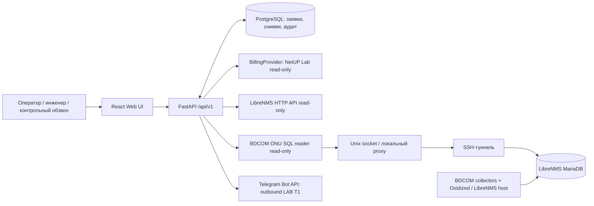

# OSS Control Center

**Service Desk и платформа диагностики абонентских подключений интернет-провайдера.**

> **Состояние описания: 17 октября 2026; сверено с кодом ветки `main` на коммите `8b7a1ea`.** Это внутренний dev/LAB-проект, а не руководство по готовому production-развёртыванию. Функции и подключения ниже разделены на реализованные и планируемые.

OSS Control Center объединяет работу первой линии, сетевых инженеров и контрольного обзвона. Оператор находит абонента по лицевому счёту, открывает обращение и видит подтверждённые сведения о подключении; инженер работает с очередью и данными сетевого мониторинга; сотрудник контрольного обзвона подтверждает результат. Для передачи задачи монтажникам предусмотрена отдельная отправка в Telegram LAB.

## Что работает

| Область | Текущее состояние |
| --- | --- |
| Service Desk | Типы заявок `SUBSCRIBER_LINKED`, `MANUAL`, `INTERNAL`; создание, категории, комментарии, очереди, назначение/взятие в работу, история, аудит, soft delete |
| Инженерный workflow | Вердикт с категорией причины и текстом решения; `IN_PROGRESS → RESOLVED`; возвращение в работу при подтверждённой проблеме |
| Контрольный обзвон | Очередь `RESOLVED`, запись результата звонка, переход в `CLOSED` либо обратно в `IN_PROGRESS` |
| Identity | Локальные учётные записи, роли и персональные разрешения, сессии, CSRF |
| Subscriber 360 | Поиск по ЛС через read-only NetUP **Lab snapshot**, контакты, услуги, связки, адрес, IP-группы с происхождением и качеством данных |
| Мониторинг | Read-only LibreNMS API; отдельное read-only чтение инвентаря и оптики BDCOM ONU из MariaDB LibreNMS |
| Выездные работы | Telegram **T1**: сохранение черновика причины и отдельная кнопка отправки в утверждённую LAB-группу; история попыток |
| Не готово | Production NetUP, Icinga runtime, входящие ответы Telegram **T2**, редактор общего шаблона/текста перед отправкой, полное production-развёртывание |

## Как устроена система

**Важно:** LibreNMS API и прямое SQL-чтение BDCOM — **два разных канала**. OSS не запускает SNMP-опросы и не управляет BDCOM-коллекторами. Производственная конфигурация NetUP не подключена. Состояние заявки живёт в PostgreSQL OSS, а не в биллинге или Telegram.

## Одна заявка — коротко

1. Оператор ищет ЛС. `BillingProvider` возвращает сведения из NetUP Lab; OSS сохраняет snapshot с источником и временем.
2. Создаётся заявка; инженер берёт её из очереди.
3. Для EPON/GPON интерфейс читает доступные наблюдения ONU с проверкой связки NetUP → OLT → PON → VLAN. Неподтверждённые кандидаты не считаются принадлежащими абоненту.
4. Инженер записывает решение: заявка переходит в `RESOLVED`.
5. При контрольном звонке подтверждение закрывает заявку; сообщение о сохраняющейся проблеме возвращает её инженерам.
6. При необходимости инженер отдельно отправляет выездную задачу Telegram-боту; эта отправка **сама по себе не закрывает заявку**.

## Технологии и расположение кода

| Слой | Код |
| --- | --- |
| Web UI | [`frontend/src/`](frontend/src/) — React/TypeScript |
| API | [`app/api/v1/`](app/api/v1/) — FastAPI |
| NetUP | [`app/modules/billing/`](app/modules/billing/) |
| LibreNMS / BDCOM | [`app/modules/diagnostics/`](app/modules/diagnostics/) |
| Заявки | [`app/modules/tickets/`](app/modules/tickets/) |
| Telegram | [`app/modules/field_dispatch/`](app/modules/field_dispatch/) |
| Identity | [`app/modules/identity/`](app/modules/identity/) |
| PostgreSQL schema | [`app/db/migrations/versions/`](app/db/migrations/versions/) — миграции до `0020_telegram_field_dispatch` |
| Dev orchestration | [`compose.dev.yaml`](compose.dev.yaml) и opt-in `compose.*.dev.yaml` |

## Документация

**Начать здесь:** [карта документации](docs/README.md).

- [Архитектура актуальной системы](docs/architecture/current-system.md) — контуры, модули, процессы, доверие к данным.
- [LibreNMS и BDCOM: путь данных](docs/integrations/librenms-bdcom.md) — SNMP → collectors → MariaDB → OSS.
- [NetUP и корреляция](docs/integrations/netup.md) — источник абонентских данных и ограничения.
- [Карта восстановления](docs/operations/recovery-map.md) — что входит в Git, а что нужно архивировать отдельно.
- [Изолированный dev-стек](docs/operations/dev-lab.md), [Telegram T1](docs/operations/telegram-field-dispatch.md), [секреты](docs/operations/secret-management.md).
- [API-контракты](docs/architecture/api-contracts.md), [RBAC](docs/architecture/rbac.md).

## Запуск, данные и безопасность

Рабочее dev-окружение развёрнуто как Compose project `oss-control-dev` с собственной PostgreSQL `oss_control_dev`. **Не путать** его с отдельным старым стеком `oss-control-center` и базой `oss_control`. Пошаговый порядок и полный набор Compose overrides — в [dev runbook](docs/operations/dev-lab.md) и [Telegram T1 runbook](docs/operations/telegram-field-dispatch.md); не заменяйте их командой `docker compose up` из корня по умолчанию.

Тесты, создающие заявки/пользователей, должны использовать только одноразовые `oss_test_*` базы. Перед миграциями постоянной БД нужен backup с **проверенным восстановлением**.

**В GitHub находятся исходники, а не работающие данные или резервная копия серверов.** Не коммитить реальные `.env`, токены, пароли, сертификатные ключи, список соответствий устройств, выгрузки абонентов, SQL-дампы, RRD и приватные конфигурации Oxidized. Кастомные PHP-коллекторы на отдельном LibreNMS-хосте не включены в этот репозиторий автоматически: их инвентаризация и безопасное версионирование остаются отдельной задачей.

Этот README — обзор текущего реализованного кода; документы прежних Phases и исторический LibreNMS-runbook не следует использовать как безусловное описание текущего runtime.
