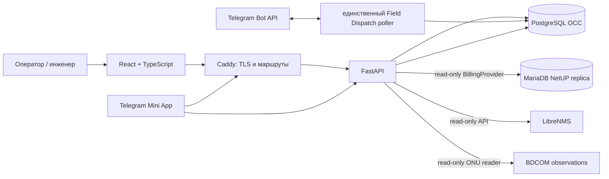

# OSS Control Center

OSS Control Center (OCC) — рабочая система Service Desk и инструментов OSS-подразделения интернет-провайдера. Она объединяет регистрацию и обработку обращений, контекст абонента, наблюдения сетевого мониторинга, выездные работы и историю действий. Цель — уменьшить повторный ручной поиск и сделать решения, передачу работ и контроль результата прослеживаемыми.

> **Статус реализации:** перечисленные ниже функции подтверждаются исходным кодом текущего `main`. Это не обещание доступности внешних источников. В read-only проверке 18.11.2026 стек Compose `oss-control-dev` был запущен; PostgreSQL отвечал, API и WEB имели health `healthy`, Telegram poller работал, а Alembic сообщал ревизию `0052_field_work_note`. Эта проверка не подтверждает DNS, доступность из внешних сетей, состояние Telegram Bot API, NetUP, LibreNMS или BDCOM. Для конкретного окружения используйте [проверки здоровья](docs/operations/health-checks.md).

## Возможности в коде

| Область | Реализованное поведение | Внешняя зависимость |
| --- | --- | --- |
| Service Desk | Заявки `SUBSCRIBER_LINKED`, `MANUAL`, `NEW_CONNECTION`, `INTERNAL`, `ERRONEOUS_PAYMENT`; назначения, комментарии, решения, обзвон, аудит, корзина | PostgreSQL OCC |
| Subscriber 360 | Поиск и карточка по данным BillingProvider; сохраняемые snapshots и история заявок/финансов | MOCK или настраиваемый read-only NetUP provider |
| Диагностика | Снимок результатов устройств/интерфейсов и ONU-кандидатов с качеством данных | LibreNMS API, BDCOM read-only reader; Icinga provider опционален |
| Выездные работы | Черновик, Telegram-доставка или публикация Mini App; отчёт, переносы и подтверждение инженером | Один Telegram bot/poller для старого группового workflow и personal outbox |
| OSS Field Work | Telegram Mini App, общая очередь, отчёты и переносы монтажников, персональные уведомления | HTTPS, Telegram `initData`, реестр доступа |
| Внутренние поручения и чат | Переписка, уведомления, прочтение; общий чат с ответами на сообщения | PostgreSQL, SSE для обновлений |
| Отчёты | Общая статистика, сотрудники, звонки, выезды, причины, PDF и XLSX | PostgreSQL, права `reports.read` |
| Управление | Пользователи и персональные permissions, настройки справочников, монтажники и доступ Field Work | PostgreSQL |

**Реализация в коде ≠ включённая интеграция.** Активные провайдеры задаются конфигурацией окружения и защищёнными файлами. Не считайте Icinga или внешний источник доступным только потому, что его adapter присутствует в репозитории.

## Архитектура и поток данных



OCC PostgreSQL — источник истины для заявок, решений, истории, аудита, сообщений, поручений и состояний Field Dispatch. Данные внешних систем сохраняются как ограниченные snapshots/наблюдения и не превращают мониторинг в решение инженера. Подробные границы и проверенные факты находятся в [архитектуре](docs/architecture/README.md).

### Жизненный цикл заявки

1. Сотрудник создаёт заявку подходящего типа. Для абонентской заявки выполняется lookup; его результат сохраняется в OCC snapshot.
2. Заявка назначается/принимается инженером и переводится в работу.
3. Инженер при необходимости запускает read-only диагностику или готовит выезд.
4. Отчёт монтажника меняет состояние выездной работы, но не закрывает Service Desk заявку.
5. Инженер фиксирует решение. Для процесса контрольного звонка результат звонка определяет закрытие или возврат в работу согласно текущему workflow.
6. События, решения и административные действия сохраняются в PostgreSQL и доступны в истории при наличии права.

Статус заявки, статус Telegram-доставки и статус выездной работы независимы.

## Безопасность и доступ

- Backend проверяет каждое действие по сохранённым персональным permissions; проверки интерфейса — только UX.
- Доступ к заявкам ограничен `tickets.read.all` / `tickets.read.own`; INTERNAL дополнительно ограничен сервером для ролей/пользователей без доступа.
- `reports.read`, `users.manage`, `settings.manage`, права задач, диагностики и Field Work проверяются отдельно.
- NetUP и monitoring credentials читаются с защищённого runtime-хранилища, не из запросов пользователя. SQL внешних readers параметризован, ограничен по времени; NetUP lookup открывает read-only snapshot.
- Секреты, конфигурации внешнего оборудования и клиентские данные не коммитятся. Политика доступа и ограничения описаны в [границах безопасности](docs/operations/security-boundaries.md).

## Стек и репозиторий

- Backend: Python 3.12–3.14, FastAPI, Pydantic, SQLAlchemy, Alembic, PostgreSQL.
- Frontend: React, TypeScript, Vite, TanStack Query, Vitest.
- Эксплуатация: Docker Compose, Caddy, Telegram Bot API; внешние read-only интеграции с MariaDB NetUP, LibreNMS и BDCOM.
- `app/api/v1/` — HTTP API; `app/modules/` — доменные модули; `app/db/migrations/versions/` — последовательные Alembic revisions; `frontend/src/` — интерфейс; `tests/` и `frontend/src/**/*.test.*` — проверки.

## Разработка

Локальная работа требует Python в диапазоне, указанном в `pyproject.toml`, Node/npm согласно `frontend/package.json` и изолированную тестовую PostgreSQL для integration tests. Не указывайте рабочий `.env` в командах и не запускайте тесты против рабочего DSN.

```bash
python -m pytest
ruff check app tests
cd frontend
npm ci
npm test
npm run typecheck
npm run build
```

Точные правила внесения изменений, миграций и deployment — [CONTRIBUTING.md](CONTRIBUTING.md). Эти команды проверок не разворачивают приложение.

## Документация

- [Индекс документации](docs/README.md)
- [Архитектура и инфраструктурные границы](docs/architecture/README.md)
- [Документы по модулям](docs/modules/README.md)
- [Эксплуатация](docs/operations/README.md)
- [ADR](docs/adr/README.md)
- [Архив исторических материалов](docs/archive/README.md)

## Ограничения и известные риски

- Git clone не восстанавливает PostgreSQL volume, секреты, кастомные LibreNMS collectors, systemd units и настройки инфраструктуры.
- Фактическая upstream-настройка репликации NetUP в MariaDB не хранится в этом репозитории.
- Сборка LibreNMS/BDCOM collectors, SNMP credentials и состояние сети принадлежат внешней инфраструктуре.
- Полное аварийное восстановление **UNVERIFIED**: наличие runbook или успешный `pg_dump` не является доказательством восстановления. Подтверждение — провести восстановление на изолированном узле и зафиксировать результат/дату.
- Внешняя доступность, сертификаты, allowlist firewall и Telegram-диалог требуют проверки на целевом окружении.
- Исторические планы и лабораторные материалы сохранены в `docs/archive/` и не являются источником текущего runtime-контракта.
