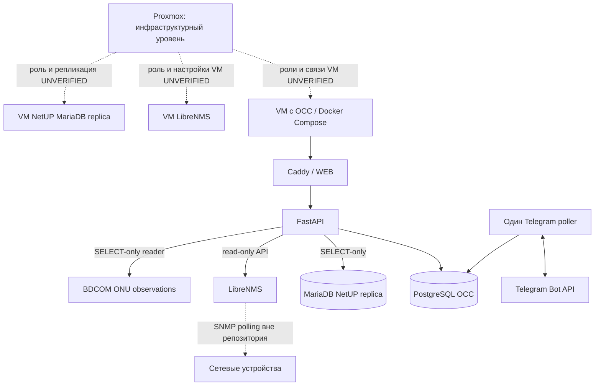

# Архитектура OSS Control Center

Эта страница описывает факты из кода и read-only наблюдение от 18.11.2026. `UNVERIFIED` означает, что репозиторий не является источником подтверждения; ниже указан безопасный путь проверки.

## Инфраструктурный контур

Наличие ролей Proxmox/VM отражает целевую инфраструктурную картину задачи. Точные VM IDs, размещение баз, маршруты, HA/репликация и настройки firewall не являются частью Git; подтвердите их в Proxmox и у владельца инфраструктуры. В read-only окружении Docker были видны сервисы Compose `oss-control-dev`; точное соответствие домену/production не выводится только из имени проекта.

## Compose и зависимости приложения

`compose.yaml` — базовый backend/PostgreSQL пример. `compose.dev.yaml` задаёт проект `oss-control-dev` с PostgreSQL, API, WEB/Caddy и seed-профилем. Дополнительные Compose overlays включают защищённую передачу Telegram credentials, отдельный Telegram T2 poller, LibreNMS monitoring и BDCOM tunnel proxy. Состав overlays зависит от утверждённого окружения; не запускайте набор по догадке.

Порядок зависимостей из Compose:

1. PostgreSQL проходит healthcheck.
2. API запускается после PostgreSQL; API readiness проверяет доступность зависимостей.
3. WEB/Caddy ждёт healthy API.
4. Telegram poller (если включён) подключается к PostgreSQL и Telegram Bot API; credentials подготавливаются отдельным runtime-механизмом.
5. BDCOM proxy и monitoring-конфигурация нужны только при включённом соответствующем источнике.

Read-only snapshot 18.11.2026 показал активные Compose overlays `compose.dev.yaml`, `compose.telegram.dev.yaml`, `compose.telegram-t2.dev.yaml`, `compose.monitoring.dev.yaml`, `compose.bdcom.dev.yaml`; labels API, WEB и poller совпадали. Это не вечная конфигурация — проверяйте actual labels. Текущие container health/revision проверяйте по [runbook health](../operations/health-checks.md). Наличие Compose-файла или образа не доказывает, что overlay активен.

## Разделение хранилищ

| Система | Роль | Кто пишет |
| --- | --- | --- |
| PostgreSQL OCC | Заявки, решения, события, snapshots, аудит, чат, поручения, Field Work и outbox | FastAPI/poller согласно транзакционным workflow |
| MariaDB NetUP replica | Биллинг и subscriber context | Внешняя NetUP replication job; OCC запускает ограниченные read-only транзакции |
| LibreNMS | Inventory и observations; OCC использует REST API, не прямой доступ к её DB | LibreNMS/collectors; движок DB и место размещения **UNVERIFIED** |
| BDCOM observations DB | Сохранённые ONU/optical observations | Внешний collector; OCC выполняет `SELECT` через настроенный reader/tunnel |

OCC-код не настраивает upstream NetUP replication: частота, задержка, GTID/binlog и восстановление реплики — **UNVERIFIED**. Подтверждение — документация владельца NetUP и read-only состояние replication на replica. LibreNMS DB engine/VM, SNMP targets, credentials, polling schedule и состав custom BDCOM collectors также **UNVERIFIED**; подтвердить в LibreNMS/collector deployment, не по OSS-коду. OCC не читает LibreNMS MariaDB напрямую: source API — единственная подтверждённая в коде связь.

### NetUP путь

`BillingProvider` выбирается конфигурацией `MOCK` или `NETUP`. NetUP repository использует параметризованные запросы, bounded query time, `REPEATABLE READ` и `START TRANSACTION ... READ ONLY`; snapshots сохраняются в PostgreSQL. OCC не пишет NetUP. То, как исходная база NetUP реплицируется в MariaDB endpoint, находится вне репозитория.

### LibreNMS и BDCOM путь

Monitoring factory по конфигурации создаёт LibreNMS и/или Icinga reader. Mapping связывает подтверждённые постоянные device IDs; порт требует отдельного явного mapping. BDCOM reader читает `bdcom_onu_olts`/`bdcom_onus`; он не меняет OLT. Пустые/неоднозначные источники отображаются как неизвестные/недоступные. Сбор SNMP и custom таблиц выполняется вне этого приложения.

### Telegram и Mini App

Групповой Field Dispatch, inbound callbacks, completion/reschedule dialogues и personal-notification outbox обрабатываются одним долгоживущим poller-процессом. Вторая копия `getUpdates` consumer недопустима. Mini App авторизуется Telegram `initData` на backend; права и разрешённое направление проверяются сервером. Telegram Bot API — транспорт, PostgreSQL — состояние передачи и истории.

## TLS и сетевые границы

`frontend/Caddyfile.dev` задаёт два TLS site: на 443 обслуживается полная SPA и API proxy; на 8443 — маршрут `/field-work`, статические assets и `/api/v1/field-work/miniapp/*`, остальные URL получают 403. Firewall allowlist не дублируется в Caddy: его источник истины — Proxmox Firewall, конфигурация которого отсутствует в Git. Внешняя доступность 8443 и точные правила DNAT/firewall **UNVERIFIED**; проверять в Proxmox и с внешнего тестового клиента. Не открывайте административный порт через другую сетевую точку.

Оба TLS site используют runtime-mounted сертификаты; содержимое приватного ключа и локальные mount paths не документируются. Caddy не должен читать секреты из Git.

## Утверждённые границы

- Нет публичного доступа к административному API через Mini App site; это проверяется Caddy configuration test/route review и отрицательными HTTP smoke tests.
- Внешние readers read-only; PostgreSQL OCC — единственная система заявок.
- Точная production-сетевая топология, live firewall state и факт TLS renewal — `UNVERIFIED` до безопасной проверки соответствующих администраторских источников.
