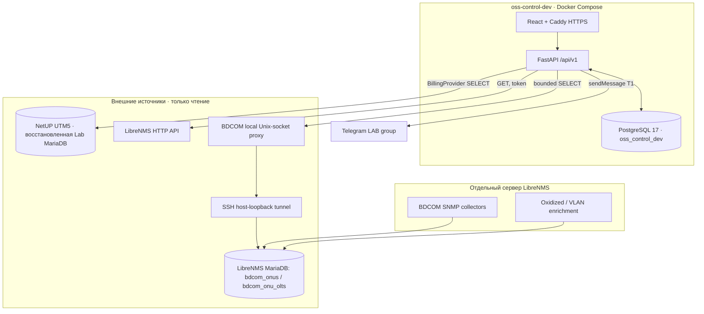
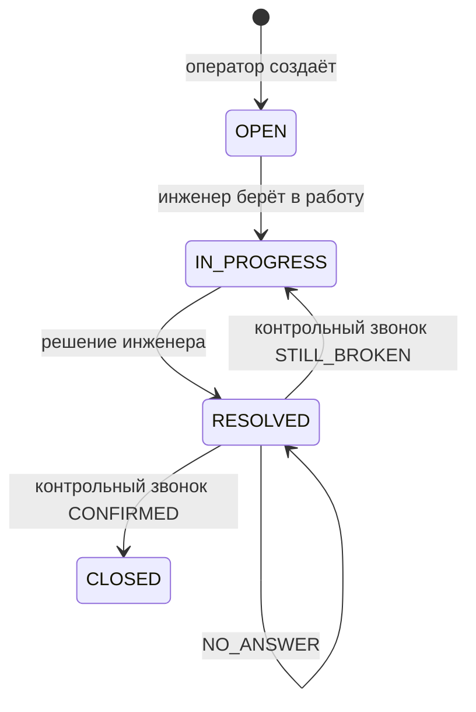

# OSS Control Center — архитектура текущей реализации

**Статус:** CURRENT, срез 17.10.2026. Сверено с OSS-кодом `main` на `8b7a1ea`; особенности LibreNMS-хоста дополнены выводами оператора от 17.10.2026. Это архитектура **изолированного dev/LAB**, не утверждение о production-готовности.

## 1. Контуры и границы

**Граница ответственности:** PostgreSQL OSS — единственный source of truth для заявок, версий, действий, историй, callback, аудита и сохранённых subscriber snapshots. NetUP — источник бизнес/топологических сведений в момент lookup, LibreNMS — источник наблюдений о сети, Telegram — транспорт выездных поручений. Финансовый статус не равен техническому состоянию; `DOWN` OLT не доказывает отказ конкретной ONU.

Важное разделение: отдельный старый Docker Compose project `oss-control-center` и его БД `oss_control` **не являются** рабочей dev-базой `oss-control-dev` / `oss_control_dev`. Они не затрагиваются миграциями, тестами или восстановлением dev.

## 2. Компоненты OSS

| Компонент | Реализация | Ответственность |
| --- | --- | --- |
| UI | `frontend/src/pages/`, `features/tickets/` | Реестры/очереди, карточка, Subscriber 360, диагностика и работа по правам |
| FastAPI | `app/api/v1/` | HTTP-контракты, session/CSRF, RBAC, validation, concurrency |
| Identity | `app/modules/identity/` | Пользователи, гранты, сессии, аудит identity |
| Billing | `app/modules/billing/` + `netup/` | `BillingProvider`, read-only lookup, нормализация и provenance |
| Tickets | `app/modules/tickets/` | Транзакционный workflow, snapshots, события, решения, callbacks |
| Diagnostics | `app/modules/diagnostics/` | LibreNMS/Icinga adapters, read-only ONU SQL reader, консервативная корреляция |
| Field dispatch | `app/modules/field_dispatch/` | Черновик и однозначно подтверждённая outbound Telegram-доставка |
| Migrations | `app/db/migrations/versions/` | Alembic от `0001` до `0020` |

Сборщики BDCOM (PHP), systemd-таймеры, Oxidized и база LibreNMS **не запускаются внутри OSS API** и не становятся частью OSS только потому, что OSS читает их данные.

## 3. Жизненный цикл связанных заявок

- Инженер сохраняет **причину решения** и текст решения; новая попытка разрешения сохраняет новую версию вердикта, не перезаписывая прошлые.
- `RESOLVED` для subscriber-linked — ещё не окончательное `CLOSED`; отдельное право `tickets.callback` контролирует результаты обзвона.
- Для `MANUAL`/`INTERNAL` действует отдельный маршрут закрытия в рамках API-контракта.
- Удаление/восстановление, индивидуальные разрешения и конкурентные изменения реализованы сервером; UI не является границей безопасности.

Источник: [Phase 5.7 callback](phase-5.7-callback.md), [Phase 5.8 UI/decision](phase-5.8-simplified-ticket-ui.md), [RBAC](rbac.md).

## 4. Поток данных: лицевой счёт → заявка

1. `POST /api/v1/subscriber-lookups` вызывает `BillingProvider`. В dev выбирается read-only NetUP Lab; источник исторический, качество включает `STALE`.
2. `repository.py` читает разрешённые таблицы UTM5 параметризованными SELECT; normalizer сохраняет многозначные строки и неопределённость.
3. API сохраняет subscriber/connection snapshot в PostgreSQL. Заявка ссылается на выбранный snapshot, а не перечитывает живой биллинг при каждом отображении.
4. Изменения после lookup — отдельные действия и аудит. Нельзя тихо заменить исторический снимок значением из мониторинга.

Подробнее: [NetUP provider](../integrations/netup.md), [data quality](../netup/data-quality.md).

## 5. Поток данных: NetUP ↔ LibreNMS ↔ ONU

**Канал A, устройство:** `NetUP switch_id` сверяется с утверждённым `librenms_device_id` из защищённого mapping-файла. LibreNMS API возвращает наблюдения о device/port. `NetUP port_id` **не равен** `LibreNMS ifIndex`; port mapping отдельный.

**Канал B, ONU:** OSS читает **только** `bdcom_onus` и `bdcom_onu_olts` из LibreNMS MariaDB через SSH tunnel / Unix socket. Сопоставление подтверждается только при уникальном OLT, проверенном `switch_id/port_id/vlan_id`, корректном PON-интерфейсе и единственной подходящей ONU. Утверждённые правила вычисления PON-порта: `NetUP.port_id − 6` для EPON, `NetUP.port_id − 13` для GPON. Без полного доказательства — `UNCONFIRMED` или `UNKNOWN/CONFLICT`, а не автоматическая привязка.

Для API проверки используются права `diagnostics.run` и явное подтверждение перед сохранением диагностического snapshot. Получение ONU-карточки read-only; она не запускает SNMP и не записывает результат как инженерный вердикт.

Подробнее: [LibreNMS/BDCOM](../integrations/librenms-bdcom.md), [диагностика](oss-diagnostics.md).

## 6. Telegram T1 — отдельный workflow

Инженер сохраняет причину выезда → `DRAFT`, затем отдельно нажимает «Отправить боту» → внешний `sendMessage` в **одну разрешённую LAB-группу**. Записываются попытки и исход: `SENT` только после подтверждения chat/message ID; `FAILED` при определённом отказе; `UNCERTAIN` при неизвестном исходе без автоматического повтора. Отправка **не** меняет статус решения заявки.

Входящие ответы монтажников и callback «Выполнено» реализованы в T2; polling
остаётся выключенным до настройки allowlist и стартового offset. Глобальный
шаблон и свободное редактирование текста сообщения не реализованы. См.
[Telegram runbook](../operations/telegram-field-dispatch.md).

## 7. Безопасность и непрерывность

- Внешние интеграции читаются по минимально необходимым правам; NetUP production не подключён, Icinga runtime не сконфигурирован.
- Секреты и device mappings хранятся в защищённых файлах вне Git. UI и API не должны логировать subscriber PII/credentials.
- HTTPS/Origin/CSRF/session/RBAC применяются на API; только React-скрытия кнопок недостаточно.
- Результаты ONU/оптики имеют собственные времена `last_seen` и `signal_updated_at`, timezone источника не подтверждена; возраст измерения обязательно различать от времени HTTP-ответа.
- Постоянная PostgreSQL dev содержит рабочие записи; mutating E2E только на отдельных `oss_test_*` БД; перед миграцией backup + проверенный restore.

## 8. Что не следует выдавать за действующую архитектуру

Исторические Phase 0/1/3 и ранний `README` содержат первоначальные планы (`OPEN → IN_PROGRESS → CLOSED`, «мониторинг позже», Telegram T2) и устаревшие инструкции. Они полезны как история решения, но при противоречии приоритет имеют текущий код и этот явно датированный срез.

Не подтверждены: production NetUP read-only, production деплой OSS, live Icinga, полный DR-план, актуальность всех PHP-коллекторов LibreNMS относительно версии от сентября. Не выполнять «восстановление» без отдельной проверки [recovery map](../operations/recovery-map.md).
