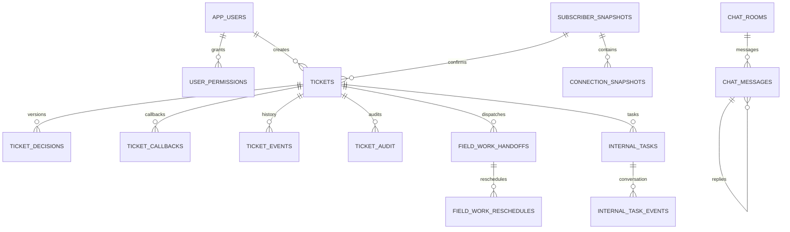

# Актуальная модель данных

PostgreSQL OCC — источник истины для заявок и workflow. MariaDB NetUP, LibreNMS и BDCOM — внешние read-only источники; данные входят в OCC только как snapshot/observation/подтверждённый mapping. Историческая модель находится в [архиве](../archive/architecture/data-model.md).

Полный состав задают SQLAlchemy models и Alembic в `app/db/migrations/versions/`. Последняя tracked revision на момент review — `0052_field_work_note`; live revision проверяется отдельно.

## Service Desk

`tickets` хранит тип, статус, приоритет, назначение, optimistic `version`, soft-delete и snapshot отображаемых значений. Типы:

- `SUBSCRIBER_LINKED` — `subscriber_snapshots`, при выборе подключения `connection_snapshots`;
- `MANUAL`, `INTERNAL` — без NetUP snapshots;
- `NEW_CONNECTION` — обязательные contact/city/address, фиксированные тема/категория;
- `ERRONEOUS_PAYMENT` — специальные payment-поля.

CHECK/FK запрещают смешивать ручной тип со snapshot, ссылать решение другой заявки, хранить неполные delete fields и противоречивые специальные поля. Service validation остаётся обязательной.

`ticket_decisions` хранит версии решений; `ticket_callbacks` — звонки; `ticket_events` — доменную историю; `ticket_audit`/purge audit — след защищённых действий. Исторические category/reason names не переписываются вслед за справочником.

## Snapshots и observations

`subscriber_snapshots`/`connection_snapshots` сохраняют source, время, TTL и нормализованные поля. Snapshot не доказывает текущую доступность. Связь обращений строится по подтверждённым ID/ЛС и source, не ФИО/телефону. Диагностические observations отделены от биллинга; отсутствие не заменяется `false`.

## Field Work

Один ticket может иметь несколько handoff. Независимые оси:

- delivery: `DRAFT`, `SENDING`, `SENT`, `FAILED`, `UNCERTAIN`, `PUBLISHED`;
- work: `AWAITING_REPORT`, `REPORTED`, `VERIFIED`.

Отдельно хранятся attempts, Telegram updates/messages, completion prompts, reschedules, installers/staff access, notification subscriptions/outbox и участники отчёта. Перенос добавляет историю. `PUBLISHED` не подменяется `SENT`.

## Tasks, chat, notifications

Internal task связывает ticket, автора и исполнителя; events и read state сохраняются в PostgreSQL. Task не меняет ticket status. Chat использует rooms, messages, `reply_to`, events и per-user read markers. OCC notifications и Telegram outbox — разные доставки; ошибка транспорта не откатывает бизнес-действие.

## Миграционные правила

1. Не менять применённую revision; добавлять следующую.
2. Проверять upgrade на восстановленной изолированной БД с counts/FK/CHECK.
3. Согласовывать schema и код; destructive downgrade не выполнять автоматически.
4. Git clone не содержит PostgreSQL volume, secrets, внешние mappings и upstream state.
