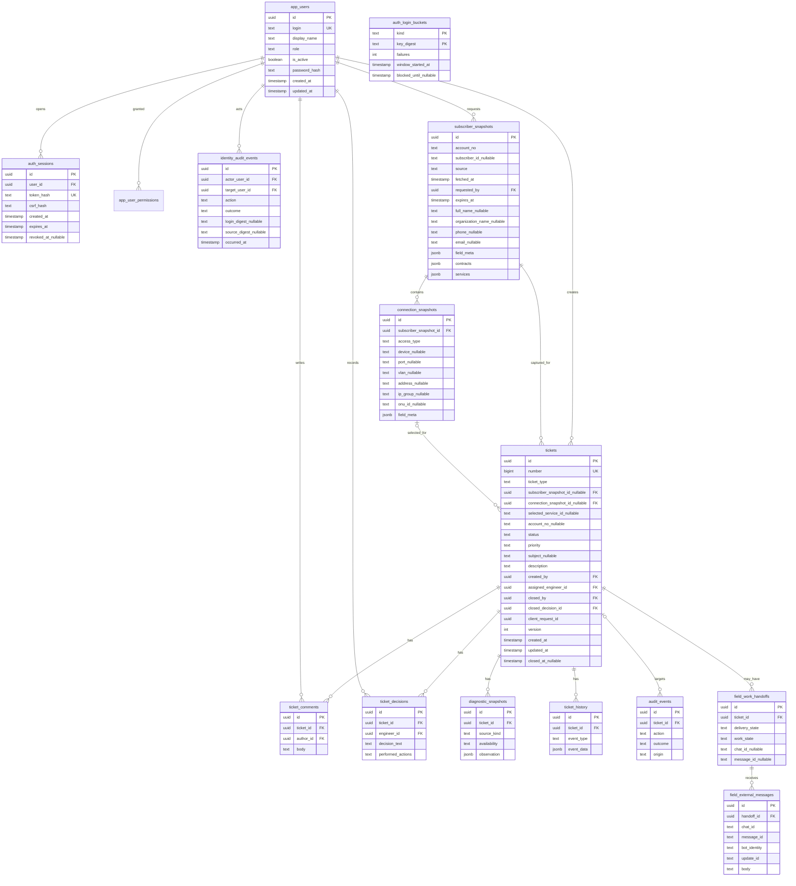

# Модель данных и ERD

**Дополнение `0015_ticket_categories`:** `ticket_categories` — управляемый справочник (`id`, уникальное без учёта регистра `name`, `sort_order`, `is_active`, `is_other`, `version`, времена). В `tickets` добавлены nullable `category_id` (FK с запретом удаления), `category_name` (неизменяемое название при создании) и `caller_phone` (неизменяемое представление номера конкретного звонка). В старых заявках все три поля остаются `NULL`: исторические тему и номер не восстанавливают догадкой. Триггер запрещает UPDATE этих исходных полей; категория может быть переименована или отключена без изменения истории. Телефон звонящего не равен контактному номеру из Billing snapshot, даже если оператор выбрал его из предложенного списка. Категория не заменяет `ticket_type` и не влияет на workflow.

**Текущее дополнение `0014_ticket_deletion`:** `tickets.deleted_at`, `deleted_by`, `delete_reason` поддерживают обратимое удаление; `ticket_purge_audit` хранит минимальный обезличенный след окончательного удаления. Политика бессрочного хранения ниже относится к заявкам до явного административного purge; исключение и порядок FK описаны в [удалении заявок](ticket-deletion.md).

Утверждённое дополнение Phase 1.4: [схема трёх типов заявок](phase-1.4-ticket-types.md). ERD и таблица прежних этапов ниже отражают subscriber-linked схему `0003`–`0007`; Stage 1 добавила ревизию `0008_ticket_types` с nullable связями, дискриминатором, CHECK/FK и защитой типа. Stage 2 использует эту схему для HTTP создания manual/internal без фиктивного Subscriber Snapshot. Исторические заявки и вся их история сохраняются бессрочно.

PostgreSQL — единственный source of truth для обращений, комментариев, решений, истории, аудита и диагностических snapshots. Данные BillingProvider сохраняются как исторический снимок, увиденный при создании заявки; актуальным источником биллинга остаётся сам провайдер. Схема ниже логическая: имена таблиц и ключи фиксируют контракт, конкретные SQL-типы и индексы оформляются версионированной миграцией Phase 1.

**Граница Phase 1.2A:** ревизия `0001_foundation` создаёт только `alembic_version`; `0002_identity_rbac` вводит четыре таблицы идентификации. Таблицы заявок и Subscriber 360 остаются для следующих шагов Phase 1.

**Phase 1.2B:** ревизия `0003_ticket_engine` ввела восемь таблиц Service Desk из ERD: `subscriber_snapshots`, `connection_snapshots`, `tickets`, `ticket_comments`, `ticket_decisions`, `ticket_history`, `audit_events`, `diagnostic_snapshots`. Снимки и дочерние факты защищены от UPDATE/DELETE триггерами; заявка допускает обновления, но не удаление. HTTP создание снимка через mock BillingProvider добавлено в Phase 1.3.

**Phase 1.3:** ревизия `0004_subscriber_360` расширяет существующие таблицы без изменения или удаления прежних данных. Новые nullable поля сохраняют совместимость старых заявок; `field_meta` для прежних снимков получает `{}`. Новые снимки создаются только через `POST /subscriber-lookups` из нормализованного mock-ответа, а не из произвольного JSON клиента.

**Stage 3C:** ревизия `0010_subscriber_finance` добавляет `financial_accounts JSONB NOT NULL DEFAULT []` к immutable `subscriber_snapshots`; старые записи остаются без искусственно восстановленного баланса. `0011_subscriber_history_index` добавляет частичный индекс `(source, subscriber_id, id)` для истории связанных заявок по нескольким счетам. Данные тарифа и биллингового состояния услуги хранятся в уже существующем `services JSONB` с собственным `field_meta`. Финансовые наблюдения никогда не определяют `technical_state` и не выдаются инженеру через Subscriber 360. Заявки и их история остаются бессрочными.

**OSS Diagnostics:** `0012_oss_diagnostics` добавляет immutable `diagnostic_checks` для неподтверждённого server-side preview связанной заявки. `diagnostic_snapshots.check_id` уникально связывает подтверждённый `AUTOMATED` snapshot с check; исторические `MANUAL` snapshots имеют `NULL`. Сохранение события истории и аудита выполняется вместе со snapshot. Кратность IP-групп и исходные строки NetUP не изменяются; см. [границу диагностики](oss-diagnostics.md).

**BDCOM ONU read-only:** `disconnection_at` и `disconnection_time_basis` —
вычисляемые nullable поля ответа из `bdcom_onus`, а не новые таблицы или
поля PostgreSQL. Исторические diagnostic snapshots не меняются; подробнее
в [контракте диагностики](oss-diagnostics.md).

**Identity и редактирование, `0013_identity_permissions`:** новые поля `app_users.must_change_password` и `permissions_customized`, таблица `app_user_permissions` с составным PK `(user_id, permission)` и FK на пользователя, `identity_audit_events.details JSONB`. Исторические пользователи получают явные гранты по прежней роли, их пароли и сессии сохраняются. Новые заявки и snapshots не мигрируются. Редактирование темы и описания использует существующие `tickets.version`, `ticket_history`, `audit_events`; новых таблиц заявок нет. История перед/после хранится в защищённом `ticket_history.event_data`, удаление истории запрещено. Последний активный admin с `users.manage` защищён серверной блокировкой и отложенным trigger при прямом SQL удалении гранта.

## ERD

`field_work_handoffs` и `field_external_messages` вводятся в Phase 3. Автоматические источники в `diagnostic_snapshots` вводятся в Phase 4; Phase 1 может сохранять ручное наблюдение инженера.

## Таблицы Phase 1

| Таблица | Обязательные поля и правила |
| --- | --- |
| `app_users` — 1.2A | UUID `id`, уникальный канонический `login`, `display_name`, `role ∈ {operator, engineer, admin}`, `is_active`, Argon2id `password_hash`, `created_at`, `updated_at`. `admin` управляет идентификацией, без прав на заявки. Первый администратор создаётся только интерактивной CLI-командой на пустой таблице. |
| `auth_sessions` — 1.2A | UUID `id`, `user_id`, SHA-256 хэши случайного токена сессии и CSRF-токена, `created_at`, `expires_at`, nullable `revoked_at`. В cookie не помещаются права или персональные данные. |
| `auth_login_buckets` — 1.2A | Составной ключ `(kind, key_digest)` для нормализованного логина и прямого адреса источника, счётчик отказов, окно и блокировка. Значения HMAC с секретом окружения, без исходного логина/IP. |
| `identity_audit_events` — 1.2A | Append-only UUID `id`, nullable актор и цель, действие, результат, HMAC логина/источника при входе, время. Без паролей, токенов и полных персональных данных. |
| `subscriber_snapshots` | `id` (= `lookup_id` в API), `account_no`, nullable `subscriber_id`, `source ∈ {MOCK, NETUP}`, `fetched_at`, `requested_by`, `expires_at`, nullable ФИО, название организации, телефон, email, договоры и услуги в JSONB, `field_meta` с источником, временем и качеством существенных полей. Phase 1 пишет только `MOCK`. Финансовые данные не входят в техническое состояние. |
| `connection_snapshots` | `id`, `subscriber_snapshot_id`, `access_type ∈ {ETHERNET, EPON, GPON, UNKNOWN}`, nullable адрес, устройство, порт, VLAN, IP-группа, ONU ID и `field_meta`. ONU не требуется и не создаётся для Ethernet или неизвестного типа. Несколько подключений сохраняются раздельно. |
| `tickets` | `id`, уникальный `number`, nullable `account_no`, `subscriber_snapshot_id`, `connection_snapshot_id`, `selected_service_id`, `subject VARCHAR(160)`, обязательное `description`, `status ∈ {OPEN, IN_PROGRESS, CLOSED}`, `priority ∈ {LOW, NORMAL, HIGH, URGENT}`, `created_by`, nullable `assigned_engineer_id`, timestamps, nullable `closed_by`/`closed_at`/`closed_decision_id`, `version`, `client_request_id`. `subject` добавлен в `0009` без заполнения исторических строк; CHECK запрещает пустое значение и управляющие символы. Для linked выбранные услуга и подключение проверяются по неизменяемому snapshot; при неоднозначности выбор явный. Уникальность `(created_by, client_request_id)` защищает создание от повторного запроса. |
| `ticket_comments` | `id`, `ticket_id`, `author_id`, `body`, `created_at`. Записи не подменяют решение или автоматические данные. |
| `ticket_decisions` | `id`, `ticket_id`, `engineer_id`, `decision_text`, `performed_actions`, `created_at`. Неизменяемые версии решения; закрытие ссылается на выбранную версию той же заявки. |
| `diagnostic_snapshots` | `id`, `ticket_id`, nullable `connection_snapshot_id`, `source_kind`, `availability ∈ {KNOWN, UNKNOWN}`, `observation`, `observed_at`, `recorded_at`, обязательный `recorded_by` для ручной проверки. В Phase 1 допускается `source_kind=MANUAL`; автоматические значения появляются только в Phase 4. |
| `ticket_history` | `id`, `ticket_id`, `event_type`, nullable `actor_id`, `event_data`, `occurred_at`. Append-only история доменных фактов: создание, начало работы, комментарий, решение, закрытие. Индекс `0009` по `(occurred_at, id)` поддерживает глобальную ленту; публичная сводка не выдаёт `event_data`. |
| `audit_events` | `id`, nullable `ticket_id`, nullable `actor_id`, `action`, `outcome`, `origin`, `occurred_at`. Append-only след изменений; полные ФИО, телефон, адрес, секреты и текст жалобы в технический аудит не копируются. Отказы доступа также отражаются в `identity_audit_events` по существующему механизму identity. |

Содержимое обращения, комментария, решения и snapshot защищено правами доступа и политикой хранения. Поиск Subscriber 360 создаёт snapshot в PostgreSQL. Начиная с ревизии `0006_lookup_cleanup`, snapshot без заявки может быть удалён контролируемой процедурой через 24 часа от `fetched_at`; это отдельный срок от `expires_at` (15 минут для создания заявки). Запись, связанная с заявкой, и история заявки сохраняются бессрочно. Дочерние connection snapshots удаляются в той же транзакции. Обезличенный `lookup_cleanup_audit` хранит время, cutoff и число удалённых записей, без ЛС и персональных данных. FK и блокировки защищают от гонки с созданием заявки. Ревизия `0007_contacts` добавляет `contacts JSONB NOT NULL DEFAULT []`: старые snapshots остаются читаемыми, новые сохраняют альтернативные телефоны с типом, источником, временем и качеством без эвристического выбора.

## Таблицы Phase 3 и независимость состояний

- `field_work_handoffs`: `id`, `ticket_id`, `created_by`, проверенный payload, `delivery_state`, `work_state`, nullable `chat_id`/`message_id`, timestamps и поля ручного fallback. `delivery_state` и `work_state` — разные колонки; ни одна не заменяет `tickets.status`.
- `field_external_messages`: `id`, `handoff_id`, `chat_id`, `message_id`, `update_id`, отправитель при разрешённом хранении, текст, время. Уникальность `(chat_id, message_id)` и `(bot_identity, update_id)` защищает от повторного импорта. Данные хранятся в PostgreSQL.
- Закрытие заявки требует отдельного решения инженера в `ticket_decisions` и обновления `tickets.status=CLOSED`. Получение сообщения или изменение `work_state` не вызывает закрытия.

## Транзакционные инварианты

Phase 5.1 не добавляет таблиц или столбцов: точная связь активных обращений
читается через `tickets.subscriber_snapshot_id` и immutable поля
`subscriber_snapshots.source/subscriber_id/account_no`. Причина явного создания
другой заявки сохраняется в `ticket_history.event_data` события
`ticket_created`; `audit_events` получает факт создания без текста причины.
`CLOSED` и soft-deleted обращения остаются в истории, но не в активной проверке.

1. Создание заявки одновременно записывает `tickets`, `ticket_history` и `audit_events` либо не записывает ничего.
2. Комментарий, ручное наблюдение, решение и закрытие сопровождаются историей и аудитом в той же транзакции.
3. `closed_by` — активный инженер OSS; `closed_at` и ссылка на решение обязательны для `CLOSED`. Закрытая заявка в Phase 1 не редактируется без отдельного будущего правила переоткрытия.
4. Данные billing snapshot, мониторинга и ручной проверки различаются по источнику. `UNKNOWN` не хранится как доказательство `DOWN`.
5. Значения `chat_id` и `message_id` появляются только после подтверждённой отправки Bot API; ручной fallback не подделывает их.

## Добавочные snapshots NetUP provider 1.0

Миграция `0005_netup_groups` расширяет immutable `subscriber_snapshots`
полями `accounts JSONB DEFAULT []` и nullable `actual_address`, а
`connection_snapshots` — nullable `service_id` и `ip_groups JSONB DEFAULT []`.
Новый JSON сохраняет `ServiceLink → IpGroupKey → IpGroupRow[]` без смешения
назначенной IP-адресации, DHCP-пула и заявленной биллинговой топологии.
Старые snapshots читаются с пустыми списками; PostgreSQL остаётся source of
truth для зафиксированного в заявке наблюдения. См.
[`ADR-001`](../netup/adr-001-provider-boundary.md).
