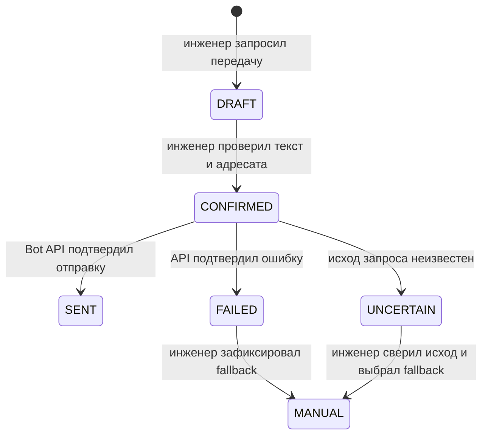

# `field_dispatch` — проект модуля передачи выездных работ

Статус: проект Phase 3. Phase 1 не создаёт бот, чат, токен и реальную Telegram-интеграцию.

## Граница ответственности

`field_dispatch` обслуживает только передачу заявки монтажному сектору и получение ответа. Он не диагностирует сеть, не меняет данные NetUP, не решает за инженера, выполнены ли работы, и не закрывает заявку. Монтажники работают в Telegram без кабинета OSS Control Center.

| Часть | Ответственность |
| --- | --- |
| Подготовка | Собрать из заявки ID, ФИО, контакт, адрес и описание, пометить отсутствующие поля, дать инженеру проверить и подтвердить конечный текст и адресата. Не получать адрес из NetUP по предположению: его подтверждённый источник ещё неизвестен. |
| Отправка | После проверки инженером отправить текст в согласованный чат через Telegram Bot API, сохранить результат попытки и полученные `chat_id`, `message_id`. Не помечать отправку успешной до подтверждения API. |
| Приём | Принять обновление способом, утверждённым перед Phase 3; проверить подлинность канала, разрешённый чат и отправителя, дедуплицировать событие, сопоставить ответ с исходным сообщением. |
| История и уведомление | Добавить связанный ответ как **внешнее сообщение** в PostgreSQL, уведомить инженера OSS внутри рабочего процесса. Не превращать текст ответа в решение или команду закрытия. |
| Fallback и аудит | При отказе Telegram или неопределённом результате сохранить причину; дать инженеру зафиксировать ручную передачу и полученный ответ. Хранить аудит действий и попыток отправки. |

## Контракт с заявкой

- Вход: `ticket_id`, данные заявки для проверяемого сообщения и контекст действующего инженера OSS. Состав персональных данных ограничен необходимым для выезда; окончательный шаблон утверждается перед Phase 3.
- Выход: `FieldWorkHandoff`, события аудита и внешнее сообщение в истории заявки. Всё хранится в PostgreSQL; ServiceDesk Plus не участвует и не синхронизируется.
- У одной заявки может быть более одной передачи. Каждая имеет собственный `handoff_id`; ответы связываются с конкретной подтверждённой отправкой по `chat_id` и `message_id` исходного сообщения.
- Если поле адреса или контакта отсутствует либо сомнительно, инженер должен уточнить его до отправки. Отсутствие поля не заполняется догадкой.

## Три независимых состояния

| Объект | Состояния | Кто и чем меняет |
| --- | --- | --- |
| Заявка | `OPEN`, `IN_PROGRESS`, `CLOSED` | Только Service Desk; закрытие — действие инженера OSS после записи решения |
| Доставка `FieldWorkHandoff` | `DRAFT`, `CONFIRMED`, `SENT`, `FAILED`, `UNCERTAIN`, `MANUAL` | Проверка инженером, результат Bot API либо подтверждённый ручной fallback |
| Работы `FieldWorkHandoff` | `AWAITING_REPORT`, `REPORTED`, `VERIFIED` | Ответ монтажника или ручная запись даёт `REPORTED`; инженерская проверка даёт `VERIFIED` |

Состояние доставки не означает выполнение работ; `REPORTED` не означает проверенное решение; ни одно из них автоматически не меняет статус заявки.

## Жизненный цикл доставки

Это только состояния доставки. Отчёт монтажника переводит состояние работ из `AWAITING_REPORT` в `REPORTED`, проверка инженера — в `VERIFIED`. Закрытие заявки остаётся отдельным действием инженера. При `UNCERTAIN` нельзя автоматически повторять отправку: Telegram мог получить сообщение, даже если подтверждение не дошло. Порядок сверки исхода утверждается до Phase 3.

## Связь ответа с передачей

Успешный [`sendMessage`](https://core.telegram.org/bots/api#sendmessage) возвращает отправленное сообщение. Для входящих обновлений Telegram предоставляет `update_id`, а ответ в том же чате может содержать `reply_to_message` с исходным сообщением. Бот с обычным режимом приватности получает ответы на свои сообщения в группе; конкретная конфигурация чата должна быть проверена до запуска. [Bot API: Update и Message](https://core.telegram.org/bots/api#update), [Bot Features: Privacy Mode](https://core.telegram.org/bots/features#privacy-mode).

1. Принять только событие от настроенного бота и разрешённого чата. Политика проверки отправителя утверждается до Phase 3; отсутствие достаточных данных ведёт к ручной проверке, а не к автоматическому импорту.
2. Дедуплицировать `update_id` в контексте бота; для записи в историю дополнительно проверять уникальность пары `chat_id` + `message_id` входящего сообщения.
3. Требовать `reply_to_message.message_id`, совпадающий с исходным `message_id` подтверждённой передачи в этом `chat_id`. Ответы без однозначной связи не прикреплять к заявке автоматически.
4. Сохранить текст ответа и доступные метаданные как внешнее сообщение, показать источник и время, уведомить инженера. Поддержка вложений, редактирования и удаления сообщений требует отдельного решения.

Если выбран webhook, проект предусматривает HTTPS и проверку секретного заголовка `X-Telegram-Bot-Api-Secret-Token`; Telegram может повторно доставить обновление после неуспешного ответа webhook, поэтому обработка должна быть идемпотентной. Выбор webhook или `getUpdates` делается перед Phase 3; одновременно они не используются. [Bot API: setWebhook и getUpdates](https://core.telegram.org/bots/api#setwebhook).

## Контроль доступа и персональных данных

- Только сетевой инженер OSS с правом передачи может подтвердить отправку, выполнить ручной fallback, проверить ответ и закрыть заявку. Монтажникам доступны только сообщения в согласованном Telegram чате.
- Список разрешённых чатов и политика допустимых отправителей настраиваются и аудируются. Чат выбирается из согласованных значений, а не из произвольного ввода пользователя.
- Токен бота и webhook secret хранятся как секреты с ограниченным доступом и ротацией; их не включают в код, URL журналов, аудит или текст ошибок.
- Перед отправкой инженер видит точный текст и адресата. В общих технических логах не сохраняются ФИО, контакт, адрес и текст жалобы; доступ к содержимому заявки, снимку сообщения и ответам ограничен и подчинён согласованному сроку хранения.
- Каждая попытка отправки имеет аудит: `handoff_id`, `ticket_id`, инженер, время проверки, адресат, технический исход и время ответа API. Полный текст хранится только там, где это требуется для истории и расследования, с ограниченными правами.

## Ручной fallback

При недоступности Telegram инженер получает явный статус ошибки или неопределённости, использует утверждённый альтернативный ручной канал и фиксирует способ, время и подтверждение передачи. Полученный вручную ответ вносится как ручная запись с автором, а не как сообщение Telegram. Альтернативный канал и правило проверки неопределённой отправки согласуются до Phase 3; они не блокируют Phase 1.
