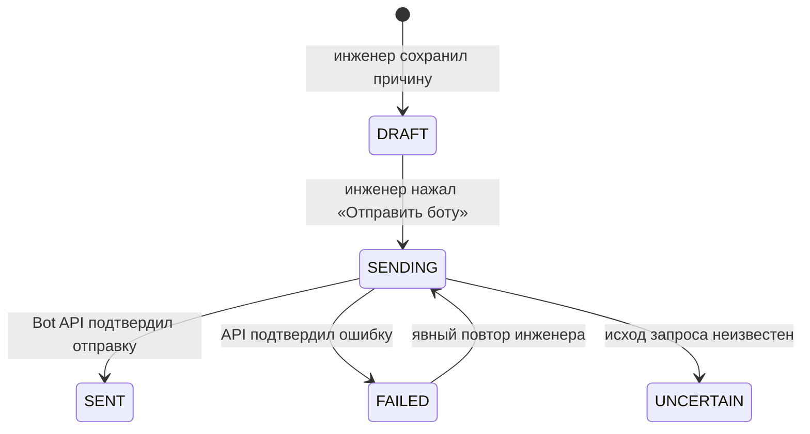

# `field_dispatch` — проект модуля передачи выездных работ

Статус: Telegram T2 реализует исходящую отправку в динамически привязанную группу Telegram,
проверенный импорт текстовых ответов и callback «✅ Выполнено», запрос
описания через ForceReply и ручное подтверждение результата инженером. Long
polling работает в отдельном opt-in Compose profile, независимо от API.

## Граница ответственности

`field_dispatch` обслуживает только передачу заявки монтажному сектору и получение ответа. Он не диагностирует сеть, не меняет данные NetUP, не решает за инженера, выполнены ли работы, и не закрывает заявку. Монтажники работают в Telegram без кабинета OSS Control Center.

| Часть | Ответственность |
| --- | --- |
| Подготовка | Сохранение причины создаёт `DRAFT` и не вызывает Telegram. Preview собирается из immutable subscriber snapshot, заявки и необязательного адреса выезда в snapshot передачи: номер, ФИО/организация, телефон звонящего либо подписанный контакт NetUP, ЛС, адрес, причина и имя инженера. При отсутствии адреса указывается «не указан»; остальные недостающие поля не угадываются. |
| Отправка | После проверки инженером отправить текст в согласованный чат через Telegram Bot API, сохранить результат попытки и полученные `chat_id`, `message_id`. Не помечать отправку успешной до подтверждения API. |
| Приём | `getUpdates` принимает `message`, `callback_query` и `my_chat_member`. `/oss_bind` меняет единственную текущую группу после проверки администратора группы и прав бота. Текст принимается только как reply на сохранённый ForceReply prompt; callback дополнительно содержит `handoff_id`. |
| История и уведомление | Добавить связанный ответ как **внешнее сообщение** в PostgreSQL, уведомить инженера OSS внутри рабочего процесса. Не превращать текст ответа в решение или команду закрытия. |
| Fallback и аудит | При отказе Telegram или неопределённом результате сохранить причину; дать инженеру зафиксировать ручную передачу и полученный ответ. Хранить аудит действий и попыток отправки. |

## Контракт с заявкой

- Вход: `ticket_id`, данные заявки для проверяемого сообщения и контекст действующего инженера OSS. Состав персональных данных ограничен необходимым для выезда; окончательный шаблон утверждается перед Phase 3.
- Выход: `FieldWorkHandoff`, события аудита и внешнее сообщение в истории заявки. Всё хранится в PostgreSQL; ServiceDesk Plus не участвует и не синхронизируется.
- У одной заявки может быть более одной передачи. Каждая имеет собственный `handoff_id`; ответы связываются с конкретной подтверждённой отправкой по `chat_id` и `message_id` исходного сообщения.
- При отсутствии адреса в NetUP инженер может указать адрес для конкретной передачи; если он не указан, отправка разрешена с текстом «Адрес: не указан». Контакт и остальные обязательные данные по-прежнему нужно уточнить до отправки. Данные NetUP не изменяются.

## Три независимых состояния

| Объект | Состояния | Кто и чем меняет |
| --- | --- | --- |
| Заявка | `OPEN`, `IN_PROGRESS`, `CLOSED` | Только Service Desk; закрытие — действие инженера OSS после записи решения |
| Доставка `FieldWorkHandoff` | `DRAFT`, `CONFIRMED`, `SENT`, `FAILED`, `UNCERTAIN`, `MANUAL` | Проверка инженером, результат Bot API либо подтверждённый ручной fallback |
| Работы `FieldWorkHandoff` | `AWAITING_REPORT`, `REPORTED`, `VERIFIED` | Ответ монтажника или ручная запись даёт `REPORTED`; инженерская проверка даёт `VERIFIED` |

Состояние доставки не означает выполнение работ; `REPORTED` не означает проверенное решение; ни одно из них автоматически не меняет статус заявки.

## Жизненный цикл доставки

Это только состояния доставки. Отчёт монтажника переводит состояние работ из `AWAITING_REPORT` в `REPORTED`, проверка инженера — в `VERIFIED`. Закрытие заявки остаётся отдельным действием инженера. При `UNCERTAIN` нельзя автоматически повторять отправку: Telegram мог получить сообщение, даже если подтверждение не дошло. Порядок сверки исхода утверждается до Phase 3.

## Связь ответа с передачей

Успешный [`sendMessage`](https://core.telegram.org/bots/api#sendmessage) возвращает отправленное сообщение. Для входящих обновлений Telegram предоставляет `update_id`, а ответ в том же чате может содержать `reply_to_message` с исходным сообщением. Бот с обычным режимом приватности получает ответы на свои сообщения в группе; конкретная конфигурация чата должна быть проверена до запуска. [Bot API: Update и Message](https://core.telegram.org/bots/api#update), [Bot Features: Privacy Mode](https://core.telegram.org/bots/features#privacy-mode).

1. Принять только событие из текущей привязанной группы или из сохранённого
   чата конкретной отправки. `/oss_bind` доступна только администратору группы;
   перед сохранением проверяются права бота. Anonymous admin, bot и отправитель
   без числового `from.id` отклоняются.
2. Дедуплицировать `update_id` в контексте бота; для записи в историю дополнительно проверять уникальность пары `chat_id` + `message_id` входящего сообщения.
3. Требовать `reply_to_message.message_id`, совпадающий с сохранённым ForceReply `message_id` в исходном чате. Если Telegram подтвердил отправку ForceReply, но ответ API потерялся, принимать только цитату сообщения от бота с точным текстом prompt и вложенной ссылкой на исходное сообщение передачи. Она может восстановить только единственный prompt в `UNCERTAIN` для этой пары chat/handoff. Обычные сообщения и ответы на исходную передачу не импортировать.
4. Сохранить текст ответа и доступные метаданные как внешнее сообщение, показать источник и время, уведомить инженера. Поддержка вложений, редактирования и удаления сообщений требует отдельного решения.

T2 использует только opt-in long polling. `update_id` сохраняется до
подтверждения следующего offset, поэтому повторная доставка безопасна. Telegram
не хранит updates дольше 24 часов, а `getUpdates` и webhook взаимоисключаются;
перед живым включением проверяется отсутствие webhook и задаётся стартовый
offset. [Bot API: getUpdates](https://core.telegram.org/bots/api#getupdates).

## Callback выполнения и подтверждение

- T1-сообщение содержит inline-кнопку `✅ Выполнено` с opaque payload
  `field_done:{handoff_id}`. UUID не является авторизацией: обработчик всё равно
  проверяет чат конкретной передачи, исходный Telegram message ID и состояние `SENT`.
- Первое допустимое нажатие создаёт receipt и `FieldWorkCompletionPrompt` в
  состоянии `REQUESTING`. Оно не переводит работы в `REPORTED`. Бот отвечает
  на сообщение передачи вопросом «Что было сделано?» с ForceReply. Поскольку
  исходное сообщение отправил бот, поэтому для участника с Telegram username
  вопрос содержит `@username` и ForceReply использует `selective`. Без username
  остаётся обычный ForceReply. Сообщение видно в группе в обоих случаях;
  ответ принимается от любого обычного участника той же группы.
- Перед сетевым вызовом prompt переходит в `UNCERTAIN`: после сбоя процесса
  повторная отправка без сверки запрещена. Подтверждённый `message_id`
  переводит его в `WAITING`; подтверждённый отказ — в `FAILED`, после чего
  участник может нажать кнопку снова. Если ответ на запрос потерялся, цитата
  ForceReply из Telegram update восстанавливает его `message_id` только при
  точном совпадении с исходным message передачи и единственном активном
  uncertain prompt.
- Текстовый reply на сохранённый или безопасно восстановленный `message_id`
  вопроса от любого обычного участника активной группы создаёт
  `COMPLETION_REPORT` и переводит работы в `REPORTED`. Текст, Telegram `date`
  и числовой Telegram User ID автора сохраняются как внешнее сообщение и аудит.
- После commit отчёта poller удаляет только сохранённый `message_id` этого
  ForceReply. Статус удаления хранится отдельно; ошибка Bot API не меняет
  `REPORTED` и повторяется с задержкой не более пяти попыток. При `UNCERTAIN`
  без подтверждённого `message_id` удаление не выполняется.
- Отдельный процесс poller загружает модели identity до записи ticket audit:
  внешний ключ `audit_events.actor_id` должен разрешаться при commit результата
  `sendMessage`. Ошибка записи не должна оставаться незамеченной; диагностика
  фиксирует только тип ошибки без текста ответа или данных участника.
- После фиксации БД poller удаляет точное сообщение отчёта по сохранённым
  `chat_id/message_id`, затем `editMessageText` обновляет исходную карточку:
  добавляет «✅ Выполнено» и имя автора, удаляет inline-кнопку. Отдельное
  подтверждение `sendMessage` больше не отправляется. Каждое действие хранит
  независимый статус и до пяти попыток с задержкой; неопределённый исход
  повторяется идемпотентно для того же сообщения. Сбой Telegram не откатывает
  `COMPLETION_REPORT` и `REPORTED`.
- Исторические T2 completion callbacks, полученные до `0022`, сохраняются
  в прежнем виде и доступны инженеру без изменения факта выполнения.
- Только сотрудник с `tickets.field_work` может перевести `REPORTED` в
  `VERIFIED`. Ни callback, ни текст, ни `VERIFIED` не меняют статус заявки,
  решение инженера или факт закрытия.

## Контроль доступа и персональных данных

- Только сетевой инженер OSS с правом передачи может подтвердить отправку, выполнить ручной fallback, проверить ответ и закрыть заявку. Монтажникам доступны только сообщения в согласованном Telegram чате.
- Текущая группа и история привязок хранятся в PostgreSQL и аудируются. Привязка
  проводится через `/oss_bind`; group→supergroup миграция сохраняет alias и не
  переписывает адресаты уже отправленных handoff. Неизвестные группы и сообщения
  без точной reply-связи не прикрепляются к заявкам.
- Токен бота и webhook secret хранятся как секреты с ограниченным доступом и ротацией; их не включают в код, URL журналов, аудит или текст ошибок.
- Перед отправкой инженер видит точный текст и адресата. В общих технических логах не сохраняются ФИО, контакт, адрес и текст жалобы; доступ к содержимому заявки, снимку сообщения и ответам ограничен и подчинён согласованному сроку хранения.
- Каждая попытка отправки имеет аудит: `handoff_id`, `ticket_id`, инженер, время проверки, адресат, технический исход и время ответа API. Полный текст хранится только там, где это требуется для истории и расследования, с ограниченными правами.

## Ручной fallback

При недоступности Telegram инженер получает явный статус ошибки или неопределённости, использует утверждённый альтернативный ручной канал и фиксирует способ, время и подтверждение передачи. Полученный вручную ответ вносится как ручная запись с автором, а не как сообщение Telegram. Альтернативный канал и правило проверки неопределённой отправки согласуются до Phase 3; они не блокируют Phase 1.
