# Service Desk workflow — утверждённая модель

**Phase 5.8:** инженер завершает работу выбором структурированной причины и
свободным текстом решения. Отдельный новый ввод «выполненных действий» и ручного
наблюдения в Web UI отсутствует; общий комментарий используется для текущих
заметок. Исторические решения и diagnostic snapshots сохраняются без изменений.
Причина хранится отдельно для каждой новой версии решения и не выводится из ONU,
мониторинга или текста автоматически.

**Phase 5.7:** [контрольный обзвон и закрытие](phase-5.7-callback.md)
уточняет путь `RESOLVED`: подтверждение абонента закрывает связанную заявку,
неуспешный звонок оставляет её в очереди, сохраняющаяся проблема возвращает
её в `IN_PROGRESS` без исполнителя. Нижеописанное закрытие инженером отражает
старые этапы; для `SUBSCRIBER_LINKED` оно больше не допускается через `/close`.

**Phase 5.6, актуальное правило:** `OPEN → IN_PROGRESS → RESOLVED → CLOSED`.
Инженер с индивидуальным `tickets.resolve` и назначением на заявку фиксирует
вердикт и выполненные действия одним `POST /resolve`; администратор с этим правом
может выполнить исключительное действие. `RESOLVED` означает «Решено, ожидает
подтверждения абонента», сохраняет исполнителя и остаётся незакрытым обращением
для предупреждения о дублях. Отдельный `POST /close` теперь допускается только
из `RESOLVED` и с текущей версией решения. Старые `CLOSED` сохраняют прежние
факты без придуманного времени инженерного решения. `POST /decisions` добавляет
неизменяемую версию вердикта; в `RESOLVED` новая версия становится текущей,
не стирая первоначальный переход статуса. Редактирование темы/описания не
меняет статус и не требует `tickets.resolve`. Очереди Phase 5.5 включают только
`OPEN` и `IN_PROGRESS`; общая выдача и история абонента включают `RESOLVED`.
Ниже встречается описание исторического трёхстатусного workflow до `0016`.

**Phase 5.5:** свободные активные `OPEN` и `IN_PROGRESS` составляют очередь ожидания инженера; закреплённые за текущим сотрудником активные заявки составляют «Взяты мной». Инженер с `tickets.start` может атомарно взять свободную заявку: исполнитель становится им самим, `OPEN → IN_PROGRESS`, либо сохраняется `IN_PROGRESS` при повторном взятии освобождённой ранее заявки. Освобождение снимает только собственное назначение и сохраняет статус и все факты; это не новый переход статуса. Повторный claim своего `IN_PROGRESS` не создаёт событие. Взятие чужой, закрытой или удалённой заявки запрещено. Ручное переназначение занятой заявки допускается только для admin с `tickets.assign` и всегда записывается в историю и аудит. Решение и закрытие по прежнему отдельные инженерные действия.

**Phase 5.4:** поиск и фильтры меняют только представление общего списка. Они не переводят заявку между `OPEN`, `IN_PROGRESS`, `CLOSED`, не создают обращения и не изменяют историю. «Не закрыты» объединяет существующие `OPEN` и `IN_PROGRESS`; корзина остаётся отдельным представлением.

**Phase 5.3, представление реестра:** сотрудник видит имя/название и ЛС связанной заявки прямо в общем списке согласно своему праву чтения. Эти сведения отражают snapshot при создании обращения; просмотр списка не запускает новый поиск NetUP и не меняет заявку или её статус. Ручные и внутренние заявки сохраняют общий workflow без фиктивного абонента.

**Создание обращения с категорией (`0015`):** после поиска ЛС оператор подтверждает карточку, выбирает активную тему и при необходимости номер входящего звонка или вводит иной номер. Комментарий необязателен; для «Другое» обязательно уточнение темы. Категория и номер фиксируются в самой заявке на момент создания. Проверка активных дубликатов по подтверждённому абоненту, явная причина «Другая проблема», идемпотентность `client_request_id` и переходы `OPEN → IN_PROGRESS → CLOSED` сохраняются. Manual и internal заявки по прежнему допускают свободный ввод без категории.

**Текущее дополнение `0014`:** soft delete и restore не меняют статус `OPEN → IN_PROGRESS → CLOSED`, а скрывают/возвращают заявку в обычной выдаче. Только отдельное подтверждённое действие purge необратимо удаляет содержимое soft-deleted заявки, сохраняя минимальный аудит; см. [контракт удаления](ticket-deletion.md).

Краткое время отключения ONU — read-only наблюдение LibreNMS. Его просмотр и
обновление GET-запросом не меняют статус заявки, её историю или audit; запись
подтверждённого диагностического результата остаётся отдельным действием API.

Текущий этап добавляет версионированное редактирование только темы и описания
до закрытия заявки. Оно не меняет статус и не заменяет Billing/diagnostic
snapshots. Событие `ticket_edited` и аудит пишутся атомарно с повышением
`tickets.version`; `If-Match` обязателен. Персональные `tickets.edit.own` и
`tickets.edit.all` проверяются независимо от `tickets.read.own/all`.
Admin теперь получает полный доступ по умолчанию по утверждённому решению;
нижеописанное ограничение «технический admin только для identity» является
историческим описанием Phase 1.2A.

Утверждённое дополнение Phase 1.4: [три пути создания заявки](phase-1.4-ticket-types.md). Диаграмма ниже показывает исходный путь `SUBSCRIBER_LINKED` через оператора; Stage 1 разрешила его также инженеру. Stage 2 вводит `MANUAL` и `INTERNAL` через HTTP без BillingProvider. Дальнейший workflow, решение инженера и срок хранения истории одинаковы для всех типов.

OSS Control Center создаёт, хранит и закрывает заявки в PostgreSQL. ServiceDesk Plus остаётся только в AS-IS и временном миграционном процессе; TO-BE workflow не вызывает его и не синхронизирует записи.

Phase 1.1 создаёт только backend foundation и health endpoints. Путь заявки ниже начинается с реализации Service Desk в следующем шаге Phase 1; сейчас эти действия не объявляются работающими.

Phase 1.2A добавляет вход и проверку роли перед действиями оператора и инженера. Технический администратор управляет учётными записями отдельно от пути заявки и не выполняет переходы её статуса.

## Целевой путь заявки

```mermaid
flowchart LR
  CALL[Звонок абонента] --> LOOKUP[Оператор ищет лицевой счёт]
  LOOKUP --> BILLING[BillingProvider возвращает Subscriber 360]
  BILLING --> CREATE[Оператор создаёт заявку]
  CREATE --> DIAG[Инженер OSS диагностирует и фиксирует результат]
  DIAG --> NEED_FIELD{Нужны выездные работы?}
  NEED_FIELD -->|Нет| DECIDE[Инженер фиксирует решение]
  NEED_FIELD -->|Да, Phase 3| PREVIEW[Инженер проверяет сообщение монтажникам]
  PREVIEW --> DISPATCH[field_dispatch отправляет или фиксирует fallback]
  DISPATCH --> REPORT[Ответ или ручной отчёт о работах]
  REPORT --> VERIFY[Инженер проверяет выполненные работы]
  VERIFY --> DECIDE
  DECIDE --> RESOLVED[Решено: ожидание подтверждения абонента]
  RESOLVED --> CONFIRM[Результат проверен после контрольного звонка]
  CONFIRM --> CLOSE[Уполномоченный сотрудник закрывает заявку]
```

Каждый Mermaid ID обозначает ровно одно действие; узел закрытия не повторно используется для получения данных. Два сетевых инженера OSS получают обращения; правила распределения между ними не вводятся. Монтажникам не нужен кабинет OSS Control Center.

## Phase 1 — Service Desk foundation

1. Оператор ищет лицевой счёт через mock BillingProvider и видит Subscriber 360 с происхождением данных `MOCK`.
2. Оператор создаёт заявку из сохранённого snapshot, добавляя описание жалобы. ФИО и контакт не вводятся повторно как обязательные поля.
3. Инженер OSS открывает заявку, при необходимости добавляет комментарии и ручной результат диагностики, фиксирует решение и закрывает заявку. Закрытие требует существующего решения и действия инженера.
4. Заявка, комментарии, решение, история и аудит сохраняются в PostgreSQL. Автоматические NetUP, Telegram и сетевые данные в Phase 1 не запрашиваются.

Если до Phase 3 нужен монтаж, передача остаётся ручным процессом миграционного периода; инженер фиксирует информацию и итог в заявке OSS Control Center. Автоматический `field_dispatch` и привязка Telegram сообщений в Phase 1 отсутствуют. ServiceDesk Plus может временно использоваться организацией при миграции, но приложение не читает и не пишет его.

## Phase 3 — выездные работы через Telegram

| Шаг | Факт и источник | Сохранение |
| --- | --- | --- |
| Подготовка | Инженер проверяет сообщение и адресата | `FieldWorkHandoff`, снимок подтверждённого текста, аудит |
| Отправка | Telegram Bot API подтверждает или не подтверждает отправку | Состояние доставки; при успехе `ticket_id`, `chat_id`, `message_id` |
| Ответ | Монтажник отвечает на исходное сообщение | Внешнее сообщение в истории; состояние работ «отчёт получен»; уведомление инженеру |
| Проверка | Инженер оценивает сообщение и выполненные работы | Состояние работ «проверено», решение в заявке |
| Закрытие | Инженер закрывает заявку | Статус заявки `CLOSED`, автор, время и аудит |
| Fallback | При недоступности Telegram инженер использует согласованный ручной способ | Причина, канал, время, результат; без ложных `chat_id`/`message_id` |

Текст «Готово» и любой иной ответ монтажника не изменяют статус заявки и не создают решение автоматически. Состояния доставки Telegram, выполненных работ и самой заявки независимы; см. [data model](data-model.md).

## Статусы заявки

Для Phase 1 используются `OPEN`, `IN_PROGRESS`, `CLOSED`. Оператор создаёт `OPEN`; инженер может начать работу (`IN_PROGRESS`), фиксирует решение и закрывает заявку (`CLOSED`). Внешние сообщения и состояния `FieldWorkHandoff` не вызывают переход в `CLOSED`. Переоткрытие и дополнительные статусы не входят в Phase 1.

Phase 5.1 проверяет `OPEN` и `IN_PROGRESS` связанные заявки перед созданием
новой. Предупреждение не меняет их статусы и не объединяет историю. Новая
заявка при другой проблеме допускается после явного указания причины; закрытые
и soft-deleted заявки не участвуют в блокировке.

Назначение инженера, комментарий, ручная диагностика, решение и запрос
выездных работ не меняют статус. Запрос выездных работ допускается из
`IN_PROGRESS` с обязательной причиной и атомарно создаёт `FieldWorkHandoff`
в `DRAFT`; Telegram при этом не вызывается. В T1 инженер отдельно проверяет
preview и запускает отправку в фиксированную LAB-группу. Повтор начала или
закрытия получает `409`. Все изменения заявки сериализуются блокировкой строки
и повышают `version`; `If-Match` обязателен для назначения, начала, запроса
выездных работ и закрытия.

Phase 1.3 добавляет поиск через синтетический mock BillingProvider. Оператор получает сохранённую карточку Subscriber 360 с `lookup_id`, источником, временем и качеством полей; при нескольких услугах или подключениях выбирает ID явно. Передача `lookup_id` в `POST /tickets` подтверждает именно показанный snapshot. Повторного ввода ФИО, контакта, адреса или сетевых идентификаторов нет. При недоступности источника карточка и snapshot не создаются (`503`); устаревшие или конфликтующие поля помечаются, но не превращаются в технический диагноз.

NetUP provider 1.0 не меняет статусы заявки. Если у найденного пользователя
несколько счетов, выбранная для заявки услуга должна относиться к
запрошенному ЛС; для другой услуги оператор сначала выполняет поиск по её
ЛС. Подключение выбирается только в пределах выбранной услуги. Несколько
строк IP-группы не считаются автоматически несколькими физическими линиями.
