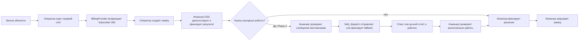

# Service Desk workflow — утверждённая модель

OSS Control Center создаёт, хранит и закрывает заявки в PostgreSQL. ServiceDesk Plus остаётся только в AS-IS и временном миграционном процессе; TO-BE workflow не вызывает его и не синхронизирует записи.

Phase 1.1 создаёт только backend foundation и health endpoints. Путь заявки ниже начинается с реализации Service Desk в следующем шаге Phase 1; сейчас эти действия не объявляются работающими.

## Целевой путь заявки

Каждый Mermaid ID обозначает ровно одно действие; узел закрытия не повторно используется для получения данных. Два сетевых инженера OSS получают обращения; правила распределения между ними не вводятся. Монтажникам не нужен кабинет OSS Control Center.

## Phase 1 — Service Desk foundation

1. Оператор ищет лицевой счёт через mock BillingProvider и видит Subscriber 360 с происхождением данных `MOCK`.
2. Оператор создаёт заявку из сохранённого snapshot, добавляя описание жалобы. ФИО и контакт не вводятся повторно как обязательные поля.
3. Инженер OSS открывает заявку, при необходимости добавляет комментарии и ручной результат диагностики, фиксирует решение и закрывает заявку. Закрытие требует существующего решения и действия инженера.
4. Заявка, комментарии, решение, история и аудит сохраняются в PostgreSQL. Автоматические NetUP, Telegram и сетевые данные в Phase 1 не запрашиваются.

Если до Phase 3 нужен монтаж, передача остаётся ручным процессом миграционного периода; инженер фиксирует информацию и итог в заявке OSS Control Center. Автоматический `field_dispatch` и привязка Telegram сообщений в Phase 1 отсутствуют. ServiceDesk Plus может временно использоваться организацией при миграции, но приложение не читает и не пишет его.

## Phase 3 — выездные работы через Telegram

| Шаг | Факт и источник | Сохранение |
| --- | --- | --- |
| Подготовка | Инженер проверяет сообщение и адресата | `FieldWorkHandoff`, снимок подтверждённого текста, аудит |
| Отправка | Telegram Bot API подтверждает или не подтверждает отправку | Состояние доставки; при успехе `ticket_id`, `chat_id`, `message_id` |
| Ответ | Монтажник отвечает на исходное сообщение | Внешнее сообщение в истории; состояние работ «отчёт получен»; уведомление инженеру |
| Проверка | Инженер оценивает сообщение и выполненные работы | Состояние работ «проверено», решение в заявке |
| Закрытие | Инженер закрывает заявку | Статус заявки `CLOSED`, автор, время и аудит |
| Fallback | При недоступности Telegram инженер использует согласованный ручной способ | Причина, канал, время, результат; без ложных `chat_id`/`message_id` |

Текст «Готово» и любой иной ответ монтажника не изменяют статус заявки и не создают решение автоматически. Состояния доставки Telegram, выполненных работ и самой заявки независимы; см. [data model](data-model.md).

## Статусы заявки

Для Phase 1 используются `OPEN`, `IN_PROGRESS`, `CLOSED`. Оператор создаёт `OPEN`; инженер может начать работу (`IN_PROGRESS`), фиксирует решение и закрывает заявку (`CLOSED`). Внешние сообщения и состояния `FieldWorkHandoff` не вызывают переход в `CLOSED`. Переоткрытие и дополнительные статусы не входят в Phase 1.
