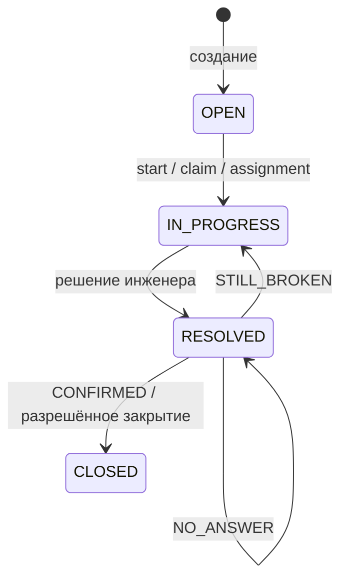

# Актуальный workflow Service Desk

Сверено с `app/modules/tickets/` и `app/api/v1/tickets.py`. Архивная фазовая версия доступна [отдельно](../archive/architecture/service-desk-workflow.md).

Backend проверяет status, assignment, permission и версию; UI не является источником разрешения.

## Типы и создание

| Тип | Обязательные данные | Нельзя |
| --- | --- | --- |
| `SUBSCRIBER_LINKED` | подтверждённый snapshot и ЛС | связывать по имени/телефону |
| `MANUAL` | ручные поля schema | создавать фиктивный NetUP snapshot |
| `NEW_CONNECTION` | ФИО, телефон, город, адрес | считать типом MANUAL |
| `INTERNAL` | внутреннее описание и visibility policy | показывать оператору через list/count/history |
| `ERRONEOUS_PAYMENT` | плательщик, два ЛС, дата/сумма | заменять специальную модель snapshot-ом |

Создание идемпотентно по `(created_by, client_request_id)`. Snapshot фиксирует момент lookup; изменения NetUP не переписывают заявку.

## Назначение, решение, звонок

Assignment/claim/start/release сохраняют историю. Редактирование требует `tickets.edit.*`; защищённые поля типа/status сервер не разрешает менять произвольно. `If-Match` предотвращает потерю параллельных изменений.

Инженер создаёт версию решения. `resolved_decision_id` задаёт актуальную версию. Назначенный инженер либо предусмотренный административный пользователь может её менять; прямой API не обходит SEC-02.

Контрольный звонок:

- `CONFIRMED` → `CLOSED`;
- `STILL_BROKEN` → `IN_PROGRESS`;
- `NO_ANSWER` → остаётся `RESOLVED`.

Каждое повторное решение/звонок — событие; отчёты отдельно считают события и уникальные tickets.

## Параллельные workflow

Field Work: отчёт переводит handoff в `REPORTED`, инженерская проверка — `VERIFIED`; ticket автоматически не закрывается. Перенос не меняет ticket status. Internal Task и диагностика также не меняют status. Финансовое состояние не является техническим.

## Удаление, аудит, INTERNAL

Удаление — soft-delete; restore/purge имеют отдельные permissions. Удалённые записи исключаются из списков/отчётов. `ticket_events` — бизнес-история, `ticket_audit` — защищённый след.

Оператор не видит INTERNAL в create, lists, search, totals, reports, previous tickets и detail. Comments/history/decisions/field work применяют тот же scope. Отдельно выданный `reports.read` не расширяет INTERNAL visibility.

Инварианты: PostgreSQL — source of truth; Telegram/task/diagnostics не закрывают ticket; исторические reason/category names неизменяемы; новый type/state требует schema, migration, backend policy, frontend types и тестов.
