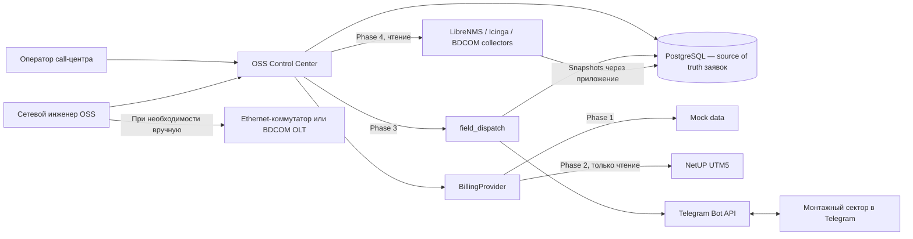

# Системная архитектура — утверждённые границы

## Контекст по фазам

Стрелки поздних фаз показывают будущие логические потоки, а не существующие подключения. ServiceDesk Plus отсутствует в TO-BE архитектуре: он используется лишь в AS-IS и временно организацией при миграции, без синхронизации с OSS Control Center.

## Phase 1

- **Service Desk:** создание заявки, комментарии, ручной результат диагностики, решение, закрытие инженером, история и аудит. Все записи находятся в PostgreSQL и выполняются с серверной проверкой RBAC.
- **Subscriber 360:** интерфейс BillingProvider возвращает данные абонента, договора, услуг и подключений. Phase 1 использует только mock реализацию. Сохранённый snapshot фиксирует данные, увиденные при создании заявки, с `source=MOCK` и временем.
- **Доступ:** роли `operator` и `engineer` для Service Desk; оба инженера имеют одинаковую роль. Техническая роль `admin` с Phase 1.2A управляет локальными учётными записями и не получает права на заявки. Первый администратор создаётся интерактивной CLI-командой; кабинета для монтажников нет.
- **Контракты:** [API contracts](api-contracts.md), [RBAC matrix](rbac.md), [data model](data-model.md). Отсутствие production API NetUP не блокирует Phase 1.

## Поздние фазы

- **Phase 2:** NetUP адаптер заменяет mock BillingProvider по тому же внутреннему контракту. Production доступ только для чтения; сопоставление подключений нельзя угадывать.
- **Phase 3:** `field_dispatch` управляет проверкой и отправкой сообщения через Telegram, входящими ответами, аудитом и fallback. Он сохраняет состояния доставки и работ отдельно от статуса заявки. Закрытие возможно только действием инженера OSS.
- **Phase 4:** LibreNMS, Icinga и BDCOM collectors дают наблюдения с источником и временем. PostgreSQL хранит диагностические snapshots. Отсутствие подтверждённого значения — `UNKNOWN`; финансовое состояние не становится техническим.
- **Phase 5:** массовые аварии, корреляция и аналитика после отдельного согласования правил.

## Хранение и надёжность

PostgreSQL — единственный source of truth для заявок, комментариев, решений, истории, аудита и диагностических snapshots. Смена статуса, запись решения, событие истории и аудит соответствующего действия записываются согласованно в одной транзакции. Чтения из BillingProvider и будущих внешних систем не объявляются источником истины для заявки; для воспроизводимости сохраняется их snapshot и происхождение. Технические логи не содержат секретов и полных персональных данных.
