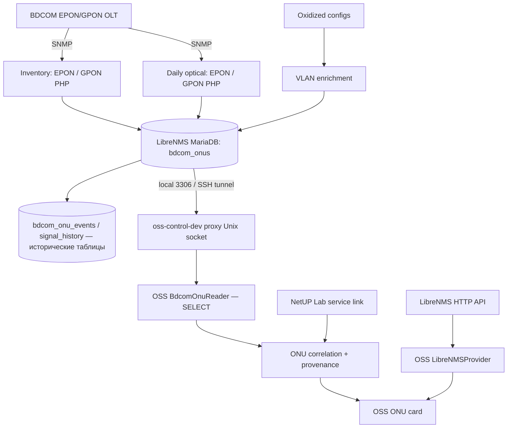

# LibreNMS + BDCOM → OSS: фактическая цепочка данных

**Источники:** (1) исторический подробный документ «LibreNMS + BDCOM PON Monitoring», срез **14.09.2026**; (2) терминальные выводы LibreNMS от **17.10.2026**; (3) исходники OSS в `main` на `8b7a1ea`. **Статус:** описание интеграции подтверждено; некоторые детали внутренних PHP-коллекторов ещё нужно сверить с полными актуальными исходниками. Исторический документ не является снимком конфигурации на 17 октября.

## 1. Два программных контура

**Контур LibreNMS (отдельный сервер):** стандартный LibreNMS poller + собственные PHP-скрипты для EPON/GPON инвентаря, состояний, VLAN и оптики + Oxidized. Результаты записываются в **MariaDB LibreNMS**.

**Контур OSS (другой сервер):** FastAPI не опрашивает OLT по SNMP. Он либо делает read-only запросы к LibreNMS HTTP API для наблюдений по устройствам, либо отдельные ограниченные `SELECT` к двум кастомным таблицам ONU.

Стрелки к таблицам истории показывают работу кастомной подсистемы LibreNMS, **не чтение истории OSS**. Текущий `BdcomOnuReader` читает только `bdcom_onus` и `bdcom_onu_olts` — не историю оптики и не события.

## 2. Найденные исходники на LibreNMS-хосте

Пути подтверждены оператором 17 октября:

| Файл / unit | Ответственность / статус |
| --- | --- |
| `local/bdcom-onu-collector.php` | EPON inventory |
| `local/bdcom-gpon-collector.php` | GPON inventory |
| `local/bdcom-vlan-sync.php` | VLAN enrichment на основе Oxidized |
| `local/bdcom-pon-collector.sh` | Последовательно EPON → GPON → VLAN; каждый запускается даже при ошибке предыдущего |
| `local/bdcom-gpon-signal-collector.php` | Daily GPON optical |
| `local/bdcom-epon-signal-collector.php` | Daily EPON optical |
| `/usr/local/sbin/oxidized-epon-backup.sh` | Backup конфигураций EPON + последующее VLAN enrichment |
| `resources/views/overview/custom/bdcom.blade.php` | Локальное кастомное представление |

Шесть `local/bdcom*` отображаются `git status` как `??` (неотслеживаемые). Файл custom view игнорируется правилом `.gitignore`. Эти файлы **не гарантированно восстанавливаются из Git-репозитория OSS или штатного upstream LibreNMS**.

В историческом документе дополнительно указан plugin `app/Plugins/BdcomOnu/{Page.php,resources/views/page.blade.php}`; его наличие/актуальность на 17 октября ещё не проверены адресным просмотром. Для полного source backup проверить также модель Oxidized `/home/oxidized/.config/oxidized/model/bdcom.rb`, список EPON узлов и systemd unit/drop-ins.

## 3. Расписание и факт выполнения

| Задача | Период | Источник |
| --- | --- | --- |
| `bdcom-onu-collector.service` | примерно каждые 5 минут через timer | исторический runbook + успешный запуск 17.10 |
| `oxidized-epon-backup.service` | 04:00 MSK | systemd 17.10 |
| `bdcom-gpon-signal.service` | 04:10 MSK | systemd 17.10, exit 0 |
| `bdcom-epon-signal.service` | 04:30 MSK | systemd 17.10, частичный сбор и exit 1 из-за SNMP timeout |

Последний EPON signal run сообщил: **1058 валидных записей**, столько же DB updates, **1 OLT timeout**. Это **частичное**, а не полное отсутствие обновлений. Владелец пояснил, что отдельное оборудование было выключено; срочных изменений скриптов по этим статусам не требуется. Время конкретной ONU проверять по её `signal_updated_at`, а не по одному `systemctl status`.

## 4. Где хранятся данные

| Таблица LibreNMS | Назначение |
| --- | --- |
| `bdcom_onu_olts` | Inventory OLT, `device_id`, hostname, тип PON |
| `bdcom_onus` | Inventory ONU; interface, MAC/Serial, state, reason, VLAN, distance, `last_seen`, ONU Rx/Tx, OLT Rx, `signal_updated_at` |
| `bdcom_onu_events` | Исторические изменения состояний ONU |
| `bdcom_onu_signal_history` | История измерений optical levels |

Фактический схематический DDL/индексы следует снять `SHOW CREATE TABLE` или `information_schema` **без экспорта строк с абонентами**, особенно перед переносом скриптов. Старый runbook не содержит полный исходный DDL и не заменяет текущую схему.

## 5. SNMP и нормализация (документировано в сентябре, требует сверки с PHP)

Для EPON historical OID mapping:

| Значение | OID |
| --- | --- |
| ONU Rx | `.1.3.6.1.4.1.3320.101.10.5.1.5.<ifIndex>` |
| ONU Tx | `.1.3.6.1.4.1.3320.101.10.5.1.6.<ifIndex>` |
| OLT Rx от ONU | `.1.3.6.1.4.1.3320.101.108.1.3.<ifIndex>` |
| ifDescr | `.1.3.6.1.2.1.2.2.1.2.<ifIndex>` |

Преобразование historical EPON raw level: `raw / 10 = dBm`; например `-243 → -24.3 dBm`. Значения `65535`/`-65535` используются как **недоступность измерения**, а не реальные dBm. Mapping: optical `ifIndex` → `ifDescr` → PON interface → `bdcom_onus.interface`. Старый runbook документирует отсутствие unmapped при тестах 14 сентября, но это не гарантирует нулевые unmapped для любых будущих OLT.

Для GPON исторически проверены MIB/OID: ONU Serial `.1.3.6.1.4.1.3320.10.3.1.1.4`, operational state `...1.8`, distance `...1.33`, deactive reason `...1.35`. Это отдельные GPON таблицы; не переносить EPON формат/scale на GPON без проверки. Реализация LibreNMS записывает в GPON поле `mac` surrogate от serial как идентификатор; OSS показывает **Serial**, а не вымышленный аппаратный MAC.

Optical collectors вынесены в daily jobs из-за нагрузки SNMP на старые OLT. Исторический runbook описывает интервал optical history в 24 часа после отказа от 30-минутной схемы; актуальную реализацию подтверждать PHP-кодом.

## 6. Как OSS читает данные

**A. LibreNMS HTTP API:** `app/modules/diagnostics/providers.py` / `correlation.py`; `LIBRENMS_TOKEN_FILE` и `MONITORING_MAPPING_FILE` передаются через защищённые read-only файлы. Одобрены только точные уникальные совпадения имени и вручную проверенные OLT. `NetUP port_id` не приравнивается к `LibreNMS ifIndex`. Нет разрешённой port mapping → interface `UNKNOWN`.

**B. BDCOM SQL:** на LibreNMS MariaDB работает локально. Защищённый SSH-tunnel на OSS-хосте оканчивается loopback, `dev/bdcom_tunnel_proxy.py` слушает защищённый Unix socket, `BdcomOnuReader` делает ограниченные parameterized `SELECT` по `bdcom_onus` и `bdcom_onu_olts` с read-only credentials. Туннель/proxy — транспорт, не сборщик и не отдельная реплика данных. Подробнее: [runbook](../operations/bdcom-onu-readonly.md).

## 7. Правило связывания с абонентом

Исходные данные `NetUP service → connection snapshot → ip_groups.rows` содержат `switch_id`, `port_id` и VLAN. Дальше:

1. Сопоставить `switch_id` только с утверждённым `librenms_device_id` из mapping registry.
2. Убедиться, что `switch_id`, `port_id`, VLAN находятся в **одной строке** NetUP, имеют допустимое качество и не противоречат соседним связкам.
3. Применить проверенное правило `PON port = NetUP port_id − 6` для EPON либо `− 13` для GPON; проверить формат интерфейса.
4. Потребовать ровно одну действующую ONU для device + PON interface + VLAN, без `truncated` и конфликтов.

Только тогда `association=MATCHED_BY_RULE`. Если доказательств недостаточно, кандидаты могут выводиться как `UNCONFIRMED`, с `UNKNOWN`/`CONFLICT`/`UNAVAILABLE` при соответствующей причине. Один VLAN **не** доказывает принадлежность ONU клиенту.

**Две разные временные шкалы:** `last_seen` = опрос inventory; `signal_updated_at` = обновление оптики; `retrieved_at` = чтение API. Часовой пояс исторических MariaDB `datetime` не подтверждён (`SOURCE_LOCAL_UNVERIFIED`). Старое значение нельзя называть «измерено сейчас».

EPON может иметь подтверждённый `last_deregister` в пределах правил plausibility. Для GPON `changed_at` не считается временем физического отключения; OSS показывает только явно обоснованное время либо UNKNOWN.

## 8. Что нужно архивировать дополнительно

- Шесть PHP/Shell коллекторов из `local/`, UI plugin/view.
- `*.service`, `*.timer` и drop-ins, а также точные зависимости/права.
- Скрипт/модель Oxidized, безопасные шаблоны конфигурации, правила VLAN enrichment.
- Структуру SQL custom таблиц (DDL, индексы), примеры тестов **только на синтетических данных**.
- SNMP OID/mapping matrix и версии firmware/MIB после сверки с исходниками.

**Нельзя** заливать в Git SNMP community, реальные credentials, `.env`, configuration backups с секретами, полные таблицы/историю ONU с абонентскими описаниями или реальный monitoring mapping registry. Сначала секрет-скан и классификация; затем отдельное решение, где хранить package с версионируемыми исходниками.

## 9. Опорные документы

- [OSS diagnostics code contract](../architecture/oss-diagnostics.md).
- [BDCOM read-only runbook](../operations/bdcom-onu-readonly.md).
- Исторический внешний документ «LibreNMS + BDCOM PON Monitoring — полная техническая документация и итоговый отчёт», датирован 14.09.2026 (в репозиторий не включён).
