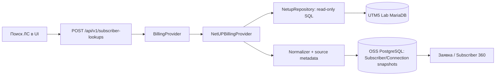

# NetUP UTM5 → OSS Control Center: источник и ограничения

**Статус:** CURRENT для кода OSS `main` на 17.10.2026; подключённый источник — восстановленная **Lab** копия UTM5 от 10.10.2026. Production биллинг не используется.

## Граница интеграции

Код: `app/modules/billing/provider.py`, `app/modules/billing/netup/{config,repository,normalizer,provider}.py`, `app/modules/billing/service.py`, `app/api/v1/billing.py`.

Только `BILLING_PROVIDER=NETUP` при явной безопасной конфигурации включает NetUP. Mock остаётся отдельным тестовым провайдером; отказ NetUP не должен тихо подменяться mock-абонентом.

## Проверенная в лабораторной копии модель

- ЛС: `accounts.id` + `users_accounts` → `users`; `users.basic_account` описывает основной счёт, но не заменяет таблицу связей.
- Услуги: `service_links` → `services_data` и подтипы (`periodic_service_links`, `iptraffic_service_links`).
- Подключение: `iptraffic_service_links.ip_group_id` → все строки `ip_groups`, в том числе `switch_id`, `port_id`, `vlan_id`, DHCP pool/ranges.
- Адрес: пользовательский `actual_address` и поле `building` (номер строения); это адрес абонента, но не доказательство физического местоположения любой услуги.
- IP: только подтверждённые поля `ip_groups.ip/mask` и диапазоны DHCP. Сырые числовые IP-типы или сведения о пуле не являются доказанным текущим DHCP-lease.

См. [relationships](../netup/relationships.md), [Subscriber 360 mapping](../netup/subscriber-360-mapping.md), [provider-data-limitations](../netup/provider-data-limitations.md).

## Качество и происхождение данных

Несколько IP-group rows под одной услугой — нормальная возможность схемы. Разные switch/port/VLAN нельзя сворачивать в одну строку через произвольный `MIN()`: при неоднозначности качество — `CONFLICT`. Отсутствие полей — `UNKNOWN`, недоступность БД — `UNAVAILABLE`, старая Lab-копия — `STALE`. Никаких выводов об online/offline ONU, оптике, неисправности или финансовом статусе линии из одной сервисной связки.

Первичный снимок записывается в OSS PostgreSQL и не зависит от последующих обновлений UTM5. При выборе конкретной услуги и подключения ссылка на снимок сохраняется в заявке. Не подменять этот снимок данными нового lookup без явной операции с provenance.

## Технические ограничения

`repository.py` использует связанные параметры SQL, read-only транзакции, лимиты по количеству счетов/услуг/IP-group rows, таймауты и контроль размера нормализованного ответа. Точные значения лимитов поддерживает [provider-data-limitations](../netup/provider-data-limitations.md), реализация в коде — первична.

Подключение Lab имеет особое исключение по TLS, допускаемое только dev-режимом к утверждённому private endpoint; **не переносить** это исключение в production. Для production потребуется согласовать отдельную read-only SQL-учётную запись, column-level права, TLS, доступ, EXPLAIN/performance и политику обновления исторических снимков.

## Где начинается диагностика

NetUP отдаёт **заявленную техническую связку**. Фактические device/ONU-наблюдения приходят через [LibreNMS / BDCOM](librenms-bdcom.md) с собственными метками времени и уверенностью в сопоставлении. Сопоставление `switch_id` с `librenms_device_id` хранится в утверждённом защищённом реестре вне Git.
